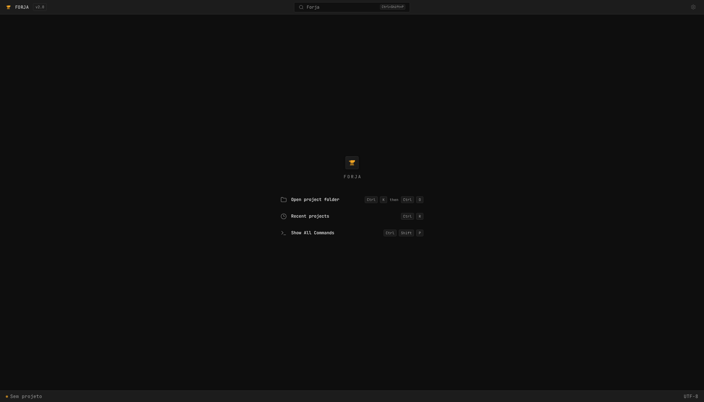

# Forja

[English](README.md) | [Português (Brasil)](README.pt-BR.md)

An opinionated AI agent development environment built around the RPI workflow, from specification to review, with you in control of every stage.



**Early scaffold:** the welcome screen is a static preview. AI integrations are not implemented yet.

## Why

Working with AI agents involves decisions, specifications, plans, code changes, tests and reviews that need to stay connected.
Forja is opinionated about the RPI workflow: Research clarifies the problem, Planner turns the approved spec into a plan, and Implementer builds from that plan before testing and review.
You remain in control of each stage through explicit approvals and visible execution.
Installed coding CLIs are execution tools within that workflow. The current repository provides the application scaffold; the guided MVP is approved and planned.

## Progress

Progress includes specification and planning as well as implementation: **SPEC 10% + PLAN 10% + validated implementation tasks 80%** per feature.

**Overall MVP:** `██████░░░░░░░░░░░░░░` **30%**. All 13 specs are approved and all 13 plans are ready. Implementation has **8/62 tasks** done: the first slice (landing and styleguide) is fully implemented and validated (independent review pending), with **0/13 slices delivered**.

| Order | Feature                             | SPEC (10%)                                                       | PLAN (10%)                                                          | Implementation (80%) | Progress                        |
| ----- | ----------------------------------- | ---------------------------------------------------------------- | ------------------------------------------------------------------- | -------------------- | ------------------------------- |
| 01    | `web-foundation-landing-styleguide` | [Approved](docs/specs/web-foundation-landing-styleguide/SPEC.md) | [Ready](docs/plans/2026-10-30-web-foundation-landing-styleguide.md) | 8/8 (review pending) | `████████████████████` **100%** |
| 02    | `cli-capability-contracts`          | [Approved](docs/specs/cli-capability-contracts/SPEC.md)          | [Ready](docs/plans/2026-10-30-cli-capability-contracts.md)          | 0/3                  | `████░░░░░░░░░░░░░░░░` **20%**  |
| 03    | `project-feature-state`             | [Approved](docs/specs/project-feature-state/SPEC.md)             | [Ready](docs/plans/2026-10-30-project-feature-state.md)             | 0/4                  | `████░░░░░░░░░░░░░░░░` **20%**  |
| 04    | `agent-settings-skills`             | [Approved](docs/specs/agent-settings-skills/SPEC.md)             | [Ready](docs/plans/2026-10-30-agent-settings-skills.md)             | 0/4                  | `████░░░░░░░░░░░░░░░░` **20%**  |
| 05    | `artifact-approval-gates`           | [Approved](docs/specs/artifact-approval-gates/SPEC.md)           | [Ready](docs/plans/2026-10-30-artifact-approval-gates.md)           | 0/5                  | `████░░░░░░░░░░░░░░░░` **20%**  |
| 06    | `feature-git-worktrees`             | [Approved](docs/specs/feature-git-worktrees/SPEC.md)             | [Ready](docs/plans/2026-10-30-feature-git-worktrees.md)             | 0/4                  | `████░░░░░░░░░░░░░░░░` **20%**  |
| 07    | `managed-command-runtime`           | [Approved](docs/specs/managed-command-runtime/SPEC.md)           | [Ready](docs/plans/2026-10-30-managed-command-runtime.md)           | 0/4                  | `████░░░░░░░░░░░░░░░░` **20%**  |
| 08    | `cli-agent-sessions`                | [Approved](docs/specs/cli-agent-sessions/SPEC.md)                | [Ready](docs/plans/2026-10-30-cli-agent-sessions.md)                | 0/7                  | `████░░░░░░░░░░░░░░░░` **20%**  |
| 09    | `feature-workbench-composer`        | [Approved](docs/specs/feature-workbench-composer/SPEC.md)        | [Ready](docs/plans/2026-10-30-feature-workbench-composer.md)        | 0/5                  | `████░░░░░░░░░░░░░░░░` **20%**  |
| 10    | `document-review-reader`            | [Approved](docs/specs/document-review-reader/SPEC.md)            | [Ready](docs/plans/2026-10-30-document-review-reader.md)            | 0/4                  | `████░░░░░░░░░░░░░░░░` **20%**  |
| 11    | `terminal-panel-footer`             | [Approved](docs/specs/terminal-panel-footer/SPEC.md)             | [Ready](docs/plans/2026-10-30-terminal-panel-footer.md)             | 0/5                  | `████░░░░░░░░░░░░░░░░` **20%**  |
| 12    | `guided-rpi-orchestration`          | [Approved](docs/specs/guided-rpi-orchestration/SPEC.md)          | [Ready](docs/plans/2026-10-30-guided-rpi-orchestration.md)          | 0/5                  | `████░░░░░░░░░░░░░░░░` **20%**  |
| 13    | `recovery-mvp-acceptance`           | [Approved](docs/specs/recovery-mvp-acceptance/SPEC.md)           | [Ready](docs/plans/2026-10-30-recovery-mvp-acceptance.md)           | 0/4                  | `████░░░░░░░░░░░░░░░░` **20%**  |

Each bar ranges from 0 to 100%. Implementation progress is proportional to validated tasks within the feature: `10 × approved spec + 10 × ready plan + 80 × (completed tasks / total tasks)`. Overall progress weights feature percentages by their implementation task counts, preserving each delivery's relative size. Independent review and final acceptance remain separate gates; progress does not mean approved delivery.

The Electron scaffold and static welcome screen are already implemented and are outside this new queue. The first planned delivery combines the bilingual landing and shared shadcn/Tailwind styleguide in `site/`, including localized product mocks.

### Landing page status

- **Deployed:** https://forjav2.web.app with `/`, `/pt-br`, `/styleguide` and `/pt-br/styleguide`. Publish with `npm run deploy:site` (Firebase project `ascode-e08f8`, hosting site `forjav2`).
- **Implemented:** bilingual landing with the seven approved sections, same-page locale switch, approved Stitch crops for the hero and the planned capabilities, mobile header and footer, favicon; bilingual styleguide with the shared components.
- **Tests:** 40 unit tests and 6 Playwright E2E tests pass. The styleguide visual baseline still needs human review.
- **Pending:** block-by-block Stitch fidelity review of the styleguide (sections 2, 3, 5 and 6) and the landing; the English crops and hero still show Portuguese interface text; independent review. All 8 plan tasks are implemented and validated; the slice counts as delivered only after that review closes.

See [ROADMAP.md](ROADMAP.md) for execution order and validation/review status, and the [plan index](docs/plans/README.md) for dependencies and implementation entry points.

## Quick start

Requires Node.js 24 or newer, npm, and a graphical desktop environment supported by Electron.
Run these commands from the repository root:

```sh
npm install
npm run dev
```

The Electron window opens on the welcome screen. No provider account or API key is required for this preview.

## Usage

The welcome screen displays project actions, a command bar, settings, and workspace status.
Controls have hover feedback and pointer cursors, but clicks and keyboard shortcuts do not perform actions yet.

To preview only the interface in a browser:

```sh
npm run dev:web
```

Open the local URL printed by Vite. This preview does not start the core process or create a database.

## Architecture

| Area                 | Implementation                                              |
| -------------------- | ----------------------------------------------------------- |
| Desktop shell        | Electron, electron-vite, electron-builder                   |
| Interface            | React, TypeScript, CSS Modules, semantic design tokens      |
| Icons and typography | Lucide, locally bundled JetBrains Mono                      |
| Core                 | Separate Electron utility process                           |
| Persistence          | SQLite through `node:sqlite`, WAL, versioned SQL migrations |
| Contracts            | Zod validation at the core message boundary                 |
| Tests                | Vitest and Testing Library                                  |

Radix and Zustand are installed for future screens; the static welcome screen does not use them.
AI adapters currently define TypeScript interfaces only. Session execution, MCP connections, approvals, credential storage, backups, and automatic updates remain unimplemented.
The renderer does not yet communicate with the core health endpoint.

The current repository contains one desktop application. The approved next delivery adds `site/` for the landing and component gallery. It stays in this repository so the site and Electron can reuse the same UI components and design tokens; it does not introduce a separate backend service or npm workspace.

```text
src/
  main/          Window and application lifecycle
  preload/       Reserved for a restricted desktop API
  core/          SQLite, core messages, and AI adapter interfaces
  shared/        Validated communication contracts
  renderer/src/
    app/         Application shell and screen composition
    shared/      Visual tokens and reusable UI
test/           Component, input validation, and database tests
```

## Development

```sh
npm test
npm run typecheck
npm run lint
npm run build
```

The build writes to `out/`. Installer targets are configured for Linux AppImage, Windows NSIS, and macOS DMG, but packaging and distribution have not been validated yet.

## Security

The renderer runs with sandboxing and context isolation enabled, with Node.js integration disabled.
The preload exposes no desktop APIs. New windows and external navigation are blocked.
The current interface does not call AI providers, execute coding CLIs, or store credentials.

The core writes `forja.db` inside Electron's application data directory. Development uses a separate `Forja Dev` directory.
The database is not encrypted. Do not store secrets in this scaffold.

The browser preview binds to the loopback interface on the port reported by Vite, without authentication.
Development servers are for local development only. The packaged application does not start an HTTP server.
Report security concerns privately to the repository maintainer, without including credentials or sensitive files.

## License

A project license has not been selected yet. No license grant is provided for the project code at this stage; dependencies retain their respective licenses.
