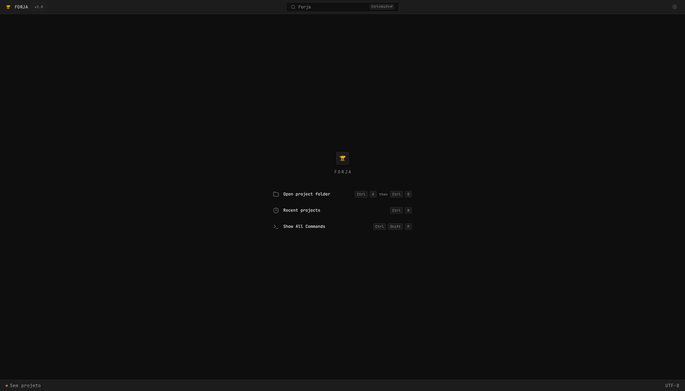

# Forja

[English](README.md) | [Português (Brasil)](README.pt-BR.md)

Um ambiente de desenvolvimento com agentes de IA, opinativo sobre o fluxo RPI, da especificação à revisão, com você no controle de cada etapa.



**Prévia de interface:** o workbench (projetos, abas de feature, conversas, documentos, configurações, terminais e painéis laterais) roda com dados mock locais, com shells reais do usuário no terminal. As integrações com agentes de IA ainda não foram implementadas.

## Por que existe

Trabalhar com agentes de IA envolve decisões, especificações, planos, alterações de código, testes e revisões que precisam continuar conectados.
O Forja é opinativo sobre o fluxo RPI: o Pesquisador entende o problema, o Planejador transforma a spec aprovada em plano e o Implementador trabalha a partir desse plano antes dos testes e da revisão.
Você permanece no controle de cada etapa, com aprovações explícitas e execução visível.
As CLIs de programação instaladas são ferramentas de execução desse fluxo. A interface está implementada com dados mock; o backend do MVP guiado está aprovado e planejado.

## Progresso

O progresso inclui a documentação e a implementação: **SPEC 10% + PLAN 10% + tarefas de implementação validadas 80%** por feature.

**MVP completo:** `███████████░░░░░░░░░` **53%**. As 27 specs ativas estão aprovadas e os 27 planos estão prontos. A implementação tem **64/155 tarefas** concluídas: a landing, o styleguide, as telas mockadas 01a a 01h e os ajustes rápidos (01j) estão implementados e validados, e a revisão de interface (01i) está implementada; 6 entregas também foram revisadas de forma independente. Em 01/11/2026 o chat passou a ser a unidade de trabalho: a spec aprovada [chat-workflow](docs/specs/chat-workflow/SPEC.md) substitui todos os planos de core ainda não implementados pelas fatias 02 a 17; as specs e os planos de core antigos foram removidos.

| Ordem | Feature | SPEC (10%) | PLAN (10%) | Implementação (80%) | Progresso |
| --- | --- | --- | --- | --- | --- |
| 01 | `web-foundation-landing-styleguide` | [Aprovada](docs/specs/web-foundation-landing-styleguide/SPEC.md) | [Pronto](docs/plans/2026-10-30-web-foundation-landing-styleguide.md) | 8/8 | `████████████████████` **100%** |
| 01a | `project-home-screen` | [Aprovada](docs/specs/project-home-screen/SPEC.md) | [Pronto](docs/plans/2026-10-31-project-home-screen.md) | 6/6 | `████████████████████` **100%** |
| 01b | `command-palette` | [Aprovada](docs/specs/command-palette/SPEC.md) | [Pronto](docs/plans/2026-10-31-command-palette.md) | 4/4 | `████████████████████` **100%** |
| 01c | `new-conversation-composer` | [Aprovada](docs/specs/new-conversation-composer/SPEC.md) | [Pronto](docs/plans/2026-10-31-new-conversation-composer.md) | 4/4 | `████████████████████` **100%** |
| 01d | `conversation-screen` | [Aprovada](docs/specs/conversation-screen/SPEC.md) | [Pronto](docs/plans/2026-10-31-conversation-screen.md) | 7/7 | `████████████████████` **100%** |
| 01e | `settings-screen` | [Aprovada](docs/specs/settings-screen/SPEC.md) | [Pronto](docs/plans/2026-10-31-settings-screen.md) | 6/6 | `████████████████████` **100%** |
| 01f | `document-viewer-screen` | [Aprovada](docs/specs/document-viewer-screen/SPEC.md) | [Pronto](docs/plans/2026-10-31-document-viewer-screen.md) | 4/4 | `████████████████████` **100%** |
| 01g | `project-sidebar-navigator` | [Aprovada](docs/specs/project-sidebar-navigator/SPEC.md) | [Pronto](docs/plans/2026-10-31-project-sidebar-navigator.md) | 6/6 | `████████████████████` **100%** |
| 01h | `conversation-agent-identity` | [Aprovada](docs/specs/conversation-agent-identity/SPEC.md) | [Pronto](docs/plans/2026-10-31-conversation-agent-identity.md) | 5/5 | `████████████████████` **100%** |
| 01i | `workbench-ui-refresh` | [Aprovada](docs/specs/workbench-ui-refresh/SPEC.md) | [Pronto](docs/plans/2026-11-01-workbench-ui-refresh.md) | 0/5 | `████░░░░░░░░░░░░░░░░` **20%** |
| 01j | `ui-quick-adjustments` | [Aprovada](docs/specs/ui-quick-adjustments/SPEC.md) | [Pronto](docs/plans/2026-11-01-ui-quick-adjustments.md) | 14/14 | `████████████████████` **100%** |
| 02 | `chat-core-store` | [Aprovada](docs/specs/chat-core-store/SPEC.md) | [Pronto](docs/plans/2026-11-01-chat-core-store.md) | 0/7 | `████░░░░░░░░░░░░░░░░` **20%** |
| 03 | `ipc-workbench-source` | [Aprovada](docs/specs/ipc-workbench-source/SPEC.md) | [Pronto](docs/plans/2026-11-01-ipc-workbench-source.md) | 0/5 | `████░░░░░░░░░░░░░░░░` **20%** |
| 04 | `cli-capability-adapters` | [Aprovada](docs/specs/cli-capability-adapters/SPEC.md) | [Pronto](docs/plans/2026-11-01-cli-capability-adapters.md) | 0/10 | `████░░░░░░░░░░░░░░░░` **20%** |
| 05 | `forja-mcp-gateway` | [Aprovada](docs/specs/forja-mcp-gateway/SPEC.md) | [Pronto](docs/plans/2026-11-01-forja-mcp-gateway.md) | 0/5 | `████░░░░░░░░░░░░░░░░` **20%** |
| 06 | `chat-turns` | [Aprovada](docs/specs/chat-turns/SPEC.md) | [Pronto](docs/plans/2026-11-01-chat-turns.md) | 0/7 | `████░░░░░░░░░░░░░░░░` **20%** |
| 07 | `artifact-publication` | [Aprovada](docs/specs/artifact-publication/SPEC.md) | [Pronto](docs/plans/2026-11-01-artifact-publication.md) | 0/5 | `████░░░░░░░░░░░░░░░░` **20%** |
| 08 | `ferreiro-orchestrator` | [Aprovada](docs/specs/ferreiro-orchestrator/SPEC.md) | [Pronto](docs/plans/2026-11-01-ferreiro-orchestrator.md) | 0/8 | `████░░░░░░░░░░░░░░░░` **20%** |
| 09 | `chat-worktrees` | [Aprovada](docs/specs/chat-worktrees/SPEC.md) | [Pronto](docs/plans/2026-11-01-chat-worktrees.md) | 0/7 | `████░░░░░░░░░░░░░░░░` **20%** |
| 10 | `test-review-loop` | [Aprovada](docs/specs/test-review-loop/SPEC.md) | [Pronto](docs/plans/2026-11-01-test-review-loop.md) | 0/3 | `████░░░░░░░░░░░░░░░░` **20%** |
| 11 | `acceptance-merge` | [Aprovada](docs/specs/acceptance-merge/SPEC.md) | [Pronto](docs/plans/2026-11-01-acceptance-merge.md) | 0/6 | `████░░░░░░░░░░░░░░░░` **20%** |
| 12 | `backlog-board-core` | [Aprovada](docs/specs/backlog-board-core/SPEC.md) | [Pronto](docs/plans/2026-11-01-backlog-board-core.md) | 0/5 | `████░░░░░░░░░░░░░░░░` **20%** |
| 13 | `terminals-runtime` | [Aprovada](docs/specs/terminals-runtime/SPEC.md) | [Pronto](docs/plans/2026-11-01-terminals-runtime.md) | 0/4 | `████░░░░░░░░░░░░░░░░` **20%** |
| 14 | `project-files-source-control` | [Aprovada](docs/specs/project-files-source-control/SPEC.md) | [Pronto](docs/plans/2026-11-01-project-files-source-control.md) | 0/4 | `████░░░░░░░░░░░░░░░░` **20%** |
| 15 | `settings-skills-usage` | [Aprovada](docs/specs/settings-skills-usage/SPEC.md) | [Pronto](docs/plans/2026-11-01-settings-skills-usage.md) | 0/3 | `████░░░░░░░░░░░░░░░░` **20%** |
| 16 | `attention-notifications` | [Aprovada](docs/specs/attention-notifications/SPEC.md) | [Pronto](docs/plans/2026-11-01-attention-notifications.md) | 0/3 | `████░░░░░░░░░░░░░░░░` **20%** |
| 17 | `recovery-acceptance` | [Aprovada](docs/specs/recovery-acceptance/SPEC.md) | [Pronto](docs/plans/2026-11-01-recovery-acceptance.md) | 0/4 | `████░░░░░░░░░░░░░░░░` **20%** |

Cada barra vai de 0 a 100%. A parcela de implementação é proporcional às tarefas validadas de cada feature: `10 × spec aprovada + 10 × plano pronto + 80 × (tarefas concluídas / total de tarefas)`. O progresso geral pondera os percentuais das features pela quantidade de tarefas de implementação, para preservar o peso de cada entrega. Revisão independente e aceite final continuam sendo critérios separados; progresso não significa entrega aprovada.

O scaffold Electron e a tela inicial estática já estão implementados e não entram nessa nova fila. A primeira entrega planejada reúne a landing bilíngue e o styleguide shadcn/Tailwind compartilhado em `site/`, com mocks do produto localizados.

### Status da landing page

- **Publicada:** https://forjav2.web.app com `/`, `/pt-br`, `/styleguide` e `/pt-br/styleguide`. Para publicar, use `npm run deploy:site` (projeto Firebase `ascode-e08f8`, site de hosting `forjav2`).
- **Implementado:** landing bilíngue com as sete seções aprovadas, troca de idioma na mesma página, recortes aprovados do Stitch no hero e nas funcionalidades planejadas, cabeçalho e rodapé para mobile, favicon; styleguide bilíngue com os componentes compartilhados.
- **Testes:** 40 testes unitários e 6 testes E2E com Playwright passam. A baseline visual do styleguide ainda precisa de revisão humana.
- **Pendente:** revisão de fidelidade ao Stitch bloco a bloco no styleguide (seções 2, 3, 5 e 6) e na landing; as versões em inglês dos recortes e o hero ainda mostram textos da interface em português; revisão independente. As 8 tarefas do plano estão implementadas e validadas; a entrega só conta como concluída depois dessa revisão.

Consulte o [roadmap em português](ROADMAP.pt-BR.md) para ver a ordem e os status de validação e revisão. O [índice dos planos, em inglês](docs/plans/README.md), contém as dependências e os comandos de implementação. As specs e os planos técnicos vinculados na tabela permanecem em inglês.

## Instalação

Requer Node.js 24 ou superior, npm e um ambiente gráfico compatível com Electron.
Execute os comandos na raiz do repositório:

```sh
npm install
npm run dev
```

A janela Electron abre na tela inicial. Esta prévia não exige conta de provedor nem chave de API.

## Uso

O aplicativo inicia sem projeto aberto. Clique em Abrir projeto (Ctrl+O) ou no botão de projeto do rodapé para selecionar um diretório; Ctrl+R abre os projetos recentes, incluindo os exemplos da prévia.
Toda página abre como aba: features, documentos, Configurações, Arquivados e Novo chat. O `+` ao lado das abas (ou Ctrl+N) abre um Novo chat; enviar um prompt cria uma aba de feature mockada com respostas roteirizadas dos agentes. Ctrl+W fecha a aba ativa, Ctrl+B mostra ou esconde a sidebar, Ctrl+Shift+P abre a paleta de comandos e Ctrl+, abre as Configurações, onde dá para trocar o idioma da interface.

Para conferir somente a interface no navegador:

```sh
npm run dev:web
```

Abra a URL local informada pelo Vite. Essa prévia não inicia o núcleo nem cria um banco de dados.

## Arquitetura

| Área                | Implementação atual                                                      |
| ------------------- | ------------------------------------------------------------------------ |
| Aplicativo desktop  | Electron, electron-vite, electron-builder                                |
| Interface           | React, TypeScript, Tailwind, shadcn/ui (Radix) e tokens Terminal Noir    |
| Ícones e tipografia | Lucide, @lobehub/icons para as ferramentas de IA, Inter e JetBrains Mono |
| Núcleo              | Utility process separado do Electron                                     |
| Persistência        | SQLite via `node:sqlite`, WAL e migrations SQL versionadas               |
| Contratos           | Validação Zod na fronteira de mensagens do núcleo                        |
| Terminais           | xterm.js e node-pty para shells reais do usuário                         |
| Testes              | Vitest, Testing Library e Playwright                                     |

O renderer usa Radix nos controles acessíveis e Zustand para navegação, features e painéis em memória.
Os adaptadores de IA definem somente interfaces TypeScript. Execução de sessões, conexões MCP, aprovações, armazenamento de credenciais, backups e atualizações automáticas ainda não foram implementados.
O renderer ainda não se comunica com o contrato de saúde do núcleo.

O repositório contém o aplicativo desktop e o `site/`, com a landing e a galeria de componentes. O site fica no mesmo repositório para compartilhar componentes de UI e tokens com o Electron, sem introduzir outro serviço de backend ou workspace npm.

```text
src/
  main/          Janela e ciclo de vida do aplicativo
  preload/       Ponte restrita para seleção de diretório
  core/          SQLite, mensagens do núcleo e interfaces dos adaptadores de IA
  shared/        Contratos de comunicação validados
  renderer/src/
    app/         Estrutura do aplicativo e composição da tela
    shared/      Tokens visuais e UI reutilizável
test/           Testes de componentes, validação de entradas e banco
```

## Desenvolvimento

```sh
npm test
npm run typecheck
npm run lint
npm run build
```

O build gera arquivos em `out/`. Há configurações de instaladores para Linux AppImage, Windows NSIS e macOS DMG, mas o empacotamento e a distribuição ainda não foram validados.

## Segurança

O renderer usa sandbox e context isolation, com integração Node.js desabilitada.
O preload expõe somente a seleção de diretório e os canais do terminal. Na seleção de diretório, o processo principal verifica a janela e o frame de origem, abre o diálogo do sistema restrito a pastas e valida o caminho selecionado; o renderer não pode enviar caminhos arbitrários nem opções de diálogo. Novas janelas e navegação externa são bloqueadas.
O painel de terminal roda o seu shell padrão via node-pty: o processo principal confere que cada pedido vem da janela dona, normaliza o diretório de trabalho, remove `ELECTRON_*` e `NODE_OPTIONS` do ambiente e limita a entrada e os tamanhos. O que você digitar ali roda com as permissões do seu usuário, como em qualquer terminal.
A interface atual não chama provedores de IA, não roda CLIs de programação como agentes e não armazena credenciais. A seleção verifica os metadados do diretório, sem ler arquivos. Os projetos selecionados ficam em memória nesta prévia. No preview web, navegadores compatíveis usam um seletor com permissão de leitura e expõem somente o nome da pasta, sem seu caminho absoluto.

O núcleo grava `forja.db` no diretório de dados do aplicativo Electron. Em desenvolvimento, usa o diretório separado `Forja Dev`.
O banco não está criptografado. Não armazene segredos neste scaffold.

A prévia web escuta na interface de loopback, na porta informada pelo Vite, sem autenticação. Em desenvolvimento, ela também responde a `GET /__forja/skills`, que só aceita pedidos de loopback e da mesma origem e só lê arquivos `SKILL.md` dentro da pasta de skills configurada.
Os servidores de desenvolvimento são apenas para uso local. O aplicativo empacotado não inicia um servidor HTTP.
Relate problemas de segurança de forma privada ao mantenedor, sem incluir credenciais ou arquivos sensíveis.

## Licença

A licença do projeto ainda não foi definida. Nesta etapa, não há concessão de licença para o código do projeto; as dependências mantêm suas respectivas licenças.
