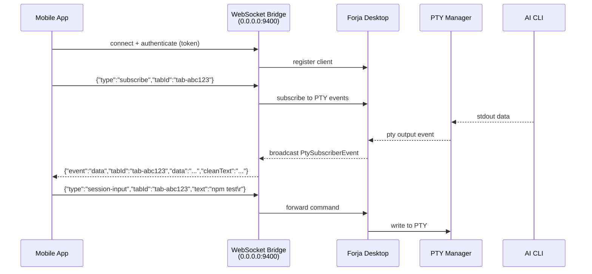

# WebSocket Bridge

The WebSocket bridge is an optional local server embedded in the Forja desktop application. It exposes a real-time WebSocket interface that allows the [Forja mobile app](/docs/mobile) to subscribe to live PTY output and send commands to active sessions — all without leaving your local network.

## Architecture



## Connection details

The bridge is disabled by default and must be enabled in Forja's settings. Once enabled, it binds to all interfaces (`0.0.0.0`) so the mobile app can connect over the local network; see [Security](#security).

| Constant | Value | Description |
|----------|-------|-------------|
| `WS_BRIDGE_PORT` | `9400` | Default port the bridge listens on |
| `WS_BRIDGE_HOST` | `127.0.0.1` | Default host for clients; the desktop bridge does not read it and binds to `0.0.0.0` |
| `WS_MAX_MESSAGES_PER_SECOND` | `10` | Rate limit per connected client |
| `WS_MAX_CLIENTS` | `5` | Maximum concurrent WebSocket connections |

These constants are exported from `@forja/shared` and used by both the desktop backend and the mobile app.

## Shared types

All messages exchanged over the WebSocket bridge use types defined in `@forja/shared`:

### `ActiveSession`

Represents an active PTY session exposed via the API.

```typescript
interface ActiveSession {
  tabId: string;
  projectPath: string;
  sessionType: string;
  displayName: string; // e.g. "Claude", "Gemini CLI"
}
```

### `ProjectInfo`

A project entry returned by `list-projects`.

```typescript
interface ProjectInfo {
  path: string;
  name: string;
}
```

### `WsBridgeStatus`

Bridge status returned by the desktop app on request.

```typescript
interface WsBridgeStatus {
  running: boolean;
  port: number;
  host: string;
  clients: number;
  token: string;
}
```

### `PtySubscriberEvent`

Events broadcast from the desktop to subscribed clients.

```typescript
type PtySubscriberEvent =
  | {
      event: "data";
      tabId: string;
      data: string;
      /**
       * Sanitized plain-text rendering of the screen buffer.
       * TUI chrome is stripped. Only present in WebSocket broadcasts.
       */
      cleanText?: string;
    }
  | { event: "session-start"; tabId: string; projectPath: string; sessionType: string }
  | { event: "session-exit"; tabId: string; projectPath: string; exitCode: number }
  | { event: "resize"; tabId: string; cols: number; rows: number };
```

### `ExternalCommand`

All commands accepted by both the Unix socket API and the WebSocket bridge.

```typescript
type ExternalCommand =
  | { type: "ping" }
  | { type: "list-sessions" }
  | { type: "list-projects" }
  | { type: "new-session"; sessionType: string; projectPath?: string }
  | { type: "close-session"; tabId: string }
  | { type: "session-output"; tabId: string }
  | { type: "session-input"; tabId: string; text: string }
  | { type: "subscribe"; tabId: string }
  | { type: "unsubscribe"; tabId: string }
  | { type: "open-project"; projectPath: string }
  | { type: "switch-project"; index: number }
  | { type: "notify"; message: string; projectPath?: string }
  | { type: "screenshot" };
```

## Security

Enabling the bridge gives any authenticated client the ability to read and type into your terminal sessions, including a plain shell. Treat it as remote shell access.

**Off by default**: The bridge only starts when you toggle it on, and stops when you toggle it off or quit Forja.

**Network exposure**: The bridge binds to `0.0.0.0:9400` so the mobile app can reach it, which makes it reachable from every device on the same network.

**PIN authentication**: A 4-digit PIN is generated each time the bridge starts and shown in Forja. The client sends it in its first message; a wrong PIN closes the connection. Comparison is timing-safe.

**Rate limiting**: Each connection is limited to 10 messages per second; messages above the limit get a `Rate limited` error.

**Client cap**: A maximum of 5 concurrent connections are allowed. New connections are rejected with an error when the cap is reached.

<Callout type="warning">
  Known limitations: a 4-digit PIN has 10,000 values and there is no lockout across reconnects, so it can be guessed by anyone on the same network; the bridge does not use TLS, so the PIN and terminal output travel in clear text. Enable it only on a network you trust and turn it off when you are done.
</Callout>

## Enabling the bridge

1. Open Forja settings (`Ctrl+,`).
2. Navigate to **Sessions > WebSocket Bridge**.
3. Toggle **Enable WebSocket Bridge** on.
4. Scan the QR code with the Forja mobile app, or enter the address and PIN manually.

The bridge starts immediately and stops when you toggle it off or quit Forja.
